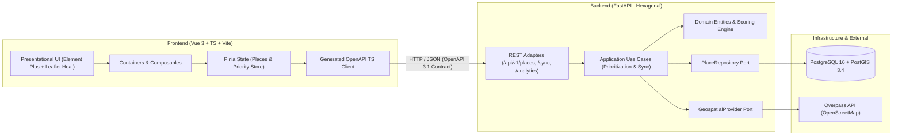

# Sistema de Priorización Geoespacial para Atención de Poblaciones Vulnerables

Plataforma web geoespacial diseñada para que instituciones de respuesta humanitaria, protección civil y salud identifiquen, clasifiquen y prioricen puntos críticos con concentración de población vulnerable (hospitales, clínicas, escuelas, kínderes, albergues, asilos y centros de alta concurrencia). El sistema ingesta datos abiertos desde **OpenStreetMap (Overpass API)**, los almacena y enriquece en **PostgreSQL + PostGIS**, y expone un contrato **OpenAPI 3.1** consumido por un dashboard interactivo en **Vue 3 + TypeScript + Element Plus + Leaflet** con mapas de calor y cola de despacho institucional.

---

## Flujo rápido del sistema (Quick Path)

1. **Ingesta geoespacial inteligente**: El operador selecciona una zona predefinida (ej. Sonsonate) o hace clic en un radio sobre el mapa; FastAPI consulta Overpass API usando cuantificadores `nwr` (*node, way, relation*) y `[timeout:60]`.
2. **Persistencia idempotente en PostGIS**: Los puntos se guardan como `GEOGRAPHY(Point, 4326)` mediante `UPSERT` (`ON CONFLICT (osm_type, osm_id)`), actualizando metadatos cartográficos sin sobrescribir la gestión operativa de la institución.
3. **Cálculo de prioridad multicriterio**: El backend calcula el `priority_score` combinando el peso base de la categoría OSM, el multiplicador de urgencia institucional, la población vulnerable estimada y la densidad espacial vecina vía PostGIS (`ST_DWithin`).
4. **Toma de decisiones visual**: El frontend renderiza el mapa de calor (`Leaflet.heat`) ponderado por `priority_score` y una tabla priorizada en Element Plus desde donde los operadores actualizan el estado (`pending`, `in_progress`, `attended`).

---

## Decisiones de arquitectura (Resultado de entrevista de diseño)

| Área | Decisión adoptada | Justificación técnica |
|------|-------------------|-----------------------|
| **Flujo operativo** | Dashboard interactivo con gestión de estados (`pending`, `in_progress`, `attended`), urgencia y población vulnerable | Permite que las instituciones usen los datos base de OSM como punto de partida para coordinar despachos reales en terreno. |
| **Alcance y sincronización** | Zonas predefinidas de El Salvador (iniciando por Sonsonate) + sincronización bajo demanda por punto/radio con `UPSERT` | Respeta las políticas de uso de Overpass API, evita consultas repetitivas desde el cliente y preserva los datos editados localmente. |
| **Categorías y puntaje** | 4 ejes (Salud, Educación/Niñez, Refugios/Vulnerabilidad directa, Alta concurrencia) + fórmula ponderada con densidad PostGIS | Incorpora etiquetas críticas de OSM como `amenity=social_facility` y mide concentración real de riesgo en radios cercanos. |
| **Acceso e infraestructura** | Acceso directo sin barrera de login para la demo + `docker-compose.yml` con `postgis/postgis:16-3.4-alpine` | Elimina fricción durante la demostración y garantiza que la extensión espacial PostGIS funcione de forma reproducible. |
| **Integración Backend-Frontend** | Contrato estricto OpenAPI 3.1 con generación automática de cliente TypeScript (`@hey-api/openapi-ts`) | Garantiza seguridad de tipos de extremo a extremo sin mantener interfaces duplicadas manualmente en Vue y FastAPI. |

---

## Antecedentes e inspiración en proyectos de GitHub

El diseño toma patrones probados de proyectos open-source líderes en cartografía humanitaria y arquitectura full-stack con FastAPI:

| Proyecto en GitHub | Propósito original | Qué adoptamos para este proyecto |
|--------------------|--------------------|----------------------------------|
| [`hotosm/tasking-manager`](https://github.com/hotosm/tasking-manager) | Plataforma del *Humanitarian OpenStreetMap Team* para coordinar mapeo y priorización de zonas en crisis humanitarias. | Flujo de trabajo por estados de atención (*pendiente -> en atención -> completado*) e indicadores de nivel de prioridad por zona. |
| [`konturio/disaster-ninja-fe`](https://github.com/konturio/disaster-ninja-fe) | Herramienta de análisis geoespacial para respuesta a desastres desarrollada junto a HOTOSM. | Visualización combinada de capas de calor, densidad poblacional e infraestructura crítica para toma de decisiones rápidas. |
| [`ushahidi/platform`](https://github.com/ushahidi/platform) | Sistema de código abierto para recolección de datos geolocalizados, triaje y respuesta en emergencias. | Clasificación por categorías de vulnerabilidad, filtros multicriterio y priorización operativa para instituciones. |
| [`fastapi/full-stack-fastapi-template`](https://github.com/fastapi/full-stack-fastapi-template) | Plantilla oficial de FastAPI con generación automática de SDK TypeScript desde OpenAPI (`@hey-api/openapi-ts`). | Pipeline de sincronización de esquemas Pydantic -> `openapi.json` -> cliente TypeScript tipado para el frontend. |
| [`geoalchemy/geoalchemy2`](https://github.com/geoalchemy/geoalchemy2) | Extensión espacial de SQLAlchemy para trabajar con tipos `Geometry`/`Geography` de PostGIS en Python. | Mapeo declarativo de puntos geográficos (`WKBElement`) y consultas espaciales indexadas con `GIST`. |

---

## Arquitectura del Sistema (Hexagonal + Screaming Architecture)

El proyecto organiza sus módulos por **capacidades de negocio** (Screaming Architecture) y separa el dominio de los detalles de infraestructura (Puertos y Adaptadores).



### Estructura de directorios propuesta

```text
geo-prioridad-vulnerable/
├── PLAN_ARQUITECTURA.md
├── docker-compose.yml                  # PostgreSQL 16 + PostGIS 3.4
├── backend/
│   ├── pyproject.toml
│   ├── alembic/                        # Migraciones de esquemas y extensión PostGIS
│   └── app/
│       ├── main.py                     # Bootstrap FastAPI + exportación OpenAPI
│       ├── core/
│       │   ├── config.py               # Variables de entorno tipadas (pydantic-settings)
│       │   └── database.py             # AsyncEngine + AsyncSession (SQLAlchemy 2.0)
│       └── modules/
│           ├── places/                 # Gestión de puntos vulnerables y estados
│           │   ├── domain/             # Entidad VulnerablePlace, enums, reglas
│           │   ├── application/        # Casos de uso (listar, actualizar estado/urgencia)
│           │   └── infrastructure/     # Modelo GeoAlchemy2, repositorio PostGIS, router
│           ├── ingestion/              # Sincronización con OpenStreetMap
│           │   ├── domain/             # Mapeo de tags OSM a categorías de vulnerabilidad
│           │   ├── application/        # Caso de uso SyncZonePlaces (idempotente)
│           │   └── infrastructure/     # Cliente HTTP asíncrono Overpass QL (httpx)
│           └── prioritization/         # Motor de cálculo de prioridad y mapa de calor
│               ├── domain/             # Fórmula de priority_score
│               ├── application/        # Agregación de calor y cola de despacho
│               └── infrastructure/     # Consultas espaciales ST_DWithin / ST_Distance
└── frontend/
    ├── package.json
    ├── openapi-ts.config.ts            # Configuración de @hey-api/openapi-ts
    └── src/
        ├── api/                        # Cliente y tipos autogenerados desde OpenAPI
        ├── modules/
        │   ├── map-Saved/              # Mapa Leaflet + capa Heatmap + marcadores
        │   ├── priority-queue/         # Tabla Element Plus de prioridad e intervención
        │   └── sync-controls/          # Selector de zona (Sonsonate, etc.) y filtros
        ├── stores/                     # Pinia stores
        └── App.vue
```

---

## Ingesta desde Overpass API y Categorías de Vulnerabilidad

### Consulta Overpass QL corregida y optimizada

En lugar de consultar únicamente nodos (`node`) y vías (`way`), se emplea el cuantificador `nwr` (*node, way, relation*) junto con `out center tags;` y el parámetro explícito `[timeout:60]`. Esto garantiza capturar complejos hospitalarios, universidades o centros comerciales mapeados como relaciones multipoligonales en OpenStreetMap:

```text
[out:json][timeout:60];
(
  nwr["amenity"~"hospital|clinic|pharmacy|school|kindergarten|university|social_facility|community_centre|marketplace|place_of_worship"](around:10000, 13.7222, -89.7236);
  nwr["shop"="mall"](around:10000, 13.7222, -89.7236);
);
out center tags;
```

### Taxonomía y Pesos Base (`category_weight`)

| Grupo de Vulnerabilidad | Etiqueta OSM (`key=value`) | Categoría Interna (`category`) | Peso Base (`category_weight`) | Justificación de Prioridad |
|-------------------------|----------------------------|--------------------------------|-------------------------------|----------------------------|
| **Salud Crítica** | `amenity=hospital` | `hospital` | `100` | Pacientes hospitalizados, cuidados intensivos y emergencias. |
| **Salud Crítica** | `amenity=clinic` | `clinic` | `85` | Atención médica primaria y pacientes ambulatorios vulnerables. |
| **Refugios y Asistencia** | `amenity=social_facility` | `social_facility` | `95` | Asilos de ancianos, albergues, orfanatos y centros de acogida. |
| **Educación y Niñez** | `amenity=kindergarten` | `kindergarten` | `90` | Primera infancia con dependencia total de evacuación/asistencia. |
| **Educación y Niñez** | `amenity=school` | `school` | `80` | Concentración masiva de menores en horario escolar. |
| **Refugios y Asistencia** | `amenity=community_centre` | `community_centre` | `75` | Puntos habituales de reunión comunitaria o albergue temporal. |
| **Educación Superior** | `amenity=university` | `university` | `65` | Alta densidad estudiantil e infraestructura apta para acopio. |
| **Salud Abastecimiento** | `amenity=pharmacy` | `pharmacy` | `60` | Punto crítico de suministro de medicamentos esenciales. |
| **Alta Concurrencia** | `amenity=marketplace` / `shop=mall` | `commercial_hub` | `55` | Alta concentración de personas en tránsito. |
| **Alta Concurrencia** | `amenity=place_of_worship` | `place_of_worship` | `50` | Espacios comunitarios frecuentemente usados como refugio local. |

---

## Modelo de Datos en PostgreSQL + PostGIS y Fórmula de Priorización

### Esquema SQL con soporte espacial (`PostGIS`)

```sql
CREATE EXTENSION IF NOT EXISTS postgis;

CREATE TABLE vulnerable_places (
    id UUID PRIMARY KEY DEFAULT gen_random_uuid(),
    osm_type VARCHAR(16) NOT NULL,                  -- 'node', 'way', 'relation'
    osm_id BIGINT NOT NULL,                         -- ID único dentro de OSM
    name VARCHAR(255) NOT NULL DEFAULT 'Sin nombre',
    category VARCHAR(50) NOT NULL,                  -- 'hospital', 'school', 'social_facility', etc.
    vulnerability_group VARCHAR(50) NOT NULL,       -- 'health', 'education', 'shelter', 'concurrency'
    zone_name VARCHAR(100) NOT NULL,                -- 'Sonsonate', 'San Salvador', etc.
    latitude DOUBLE PRECISION NOT NULL,
    longitude DOUBLE PRECISION NOT NULL,
    location GEOGRAPHY(Point, 4326) NOT NULL,       -- Punto geográfico PostGIS en metros reales
    osm_tags JSONB NOT NULL DEFAULT '{}'::jsonb,    -- Etiquetas crudas de OSM (teléfono, dirección, etc.)

    -- Campos operativos gestionados por la institución (preservados en cada UPSERT de OSM)
    attention_status VARCHAR(32) NOT NULL DEFAULT 'pending', -- 'pending', 'in_progress', 'attended'
    urgency_level INTEGER NOT NULL DEFAULT 3 CHECK (urgency_level BETWEEN 1 AND 5),
    estimated_vulnerable_count INTEGER NOT NULL DEFAULT 0 CHECK (estimated_vulnerable_count >= 0),
    institution_notes TEXT,

    -- Puntaje calculado para ordenamiento rápido y mapa de calor
    category_weight INTEGER NOT NULL,
    priority_score DOUBLE PRECISION NOT NULL DEFAULT 0,

    last_osm_sync_at TIMESTAMPTZ NOT NULL DEFAULT NOW(),
    updated_at TIMESTAMPTZ NOT NULL DEFAULT NOW(),

    CONSTRAINT uq_osm_element UNIQUE (osm_type, osm_id)
);

CREATE INDEX idx_vulnerable_places_location ON vulnerable_places USING GIST (location);
CREATE INDEX idx_vulnerable_places_priority ON vulnerable_places (priority_score DESC);
CREATE INDEX idx_vulnerable_places_zone_category ON vulnerable_places (zone_name, category);
```

### Motor Matemático de Priorización (`priority_score`)

El puntaje de prioridad combina la criticidad estructural del lugar, la evaluación humana de la institución y el contexto espacial calculado con PostGIS:

$$
\text{priority\_score} = \left( W_{\text{cat}} \times M_{\text{urg}} \right) + \left( 15 \times \ln(1 + P_{\text{vuln}}) \right) + \left( 5 \times N_{\text{500m}} \right)
$$

Donde:
- $W_{\text{cat}}$: Peso base de la categoría (`50` a `100`).
- $M_{\text{urg}}$: Multiplicador del nivel de urgencia (`1 -> 0.6`, `2 -> 0.8`, `3 -> 1.0`, `4 -> 1.3`, `5 -> 1.6`).
- $P_{\text{vuln}}$: Cantidad estimada de personas vulnerables ingresada por la institución (amortiguada con logaritmo natural para que un número alto no eclipse por completo a otros centros críticos).
- $N_{\text{500m}}$: Cantidad de otros puntos vulnerables en un radio de 500 metros calculada con `ST_DWithin(location, target.location, 500)`, premiando la intervención en clústeres donde una brigada puede cubrir múltiples puntos cercanos.
- Si `attention_status = 'attended'`, la intensidad en la capa activa de emergencia se atenúa al `20%` (o se filtra según el selector del operador) para enfocar la atención en los lugares pendientes.

---

## Contrato OpenAPI 3.1 y Diseño Frontend (Vue 3 + Element Plus)

### Endpoints principales del Backend (FastAPI)

| Método | Ruta | Operación (`operation_id`) | Descripción |
|--------|------|----------------------------|-------------|
| `GET` | `/api/v1/zones` | `listPredefinedZones` | Devuelve las zonas configuradas (Sonsonate, San Salvador, Santa Ana, San Miguel, etc.) con coordenadas centrales y radio sugerido. |
| `POST` | `/api/v1/places/sync` | `syncPlacesFromOverpass` | Ejecuta la consulta a Overpass API para una zona o coordenada `(lat, lon, radius_meters)` y realiza el `UPSERT` en PostGIS. |
| `GET` | `/api/v1/places` | `listPrioritizedPlaces` | Lista lugares filtrados por zona, categoría, grupo de vulnerabilidad, estado de atención o radio espacial, ordenados por `priority_score DESC`. |
| `PATCH` | `/api/v1/places/{place_id}` | `updatePlaceTriage` | Actualiza `attention_status`, `urgency_level`, `estimated_vulnerable_count` e `institution_notes`, recalculando el `priority_score`. |
| `GET` | `/api/v1/places/heatmap` | `getHeatmapData` | Devuelve la matriz optimizada `[lat, lon, normalized_intensity]` y KPIs agregados para el dashboard. |

### Flujo de generación de tipos (Contract-First / Codegen)

1. FastAPI define `response_model` estrictos en Pydantic v2 con `operation_id` explícitos.
2. El script `pnpm run generate:api` en el frontend ejecuta `@hey-api/openapi-ts` apuntando a `http://localhost:8000/openapi.json`.
3. Los stores de Pinia importan directamente las funciones y tipos autogenerados (`PlaceRead`, `PlaceTriageUpdate`, `SyncZoneRequest`), eliminando errores de serialización.

### Distribución visual del Dashboard (Element Plus + Leaflet)

- **Barra superior (`ElHeader`)**: Selector de zona predefinida (`ElSelect`), botón de sincronización con Overpass (`ElButton` con estado `loading`), interruptor de modo clic en mapa para radio personalizado y tarjetas de resumen (`ElStatistic`: Total puntos, Críticos pendientes, En atención, Atendidos).
- **Panel izquierdo — Mapa Interactivo (60% ancho)**:
  - Mapa base OpenStreetMap con `Leaflet`.
  - Capa de calor (`leaflet.heat`) ponderada por la intensidad normalizada de `priority_score` (gradiente azul -> amarillo -> naranja -> rojo intenso).
  - Marcadores diferenciados por grupo de vulnerabilidad y estado de atención con popup informativo.
- **Panel derecho — Cola de Despacho Institucional (40% ancho)**:
  - Filtros rápidos por categoría (`ElSelect`), grupo y estado (`ElSegmented` / `ElRadioGroup`).
  - Tabla priorizada (`ElTable`) ordenada de mayor a menor `priority_score` con etiquetas semánticas (`ElTag`).
  - Al seleccionar una fila, el mapa hace *flyTo* hacia las coordenadas del lugar y abre un cajón lateral o modal (`ElDrawer`) con `ElForm`, `ElRate`/`ElSlider` para nivel de urgencia, `ElInputNumber` para población vulnerable y cambio de estado (`Pendiente` / `En atención` / `Atendido`).

---

## Plan de Implementación por Fases (Checklist)

- [x] **Fase 1 — Infraestructura y Base de Datos Espacial**: Crear `docker-compose.yml` con PostgreSQL 16 + PostGIS 3.4, configurar entorno Python en `backend/` y migración inicial con la tabla `vulnerable_places` e índice `GIST`.
- [x] **Fase 2 — Motor de Ingesta Overpass y Dominio de Priorización**: Implementar el adaptador asíncrono de Overpass API (`nwr` + `[timeout:60]`), el clasificador de categorías de vulnerabilidad, el repositorio PostGIS con `UPSERT` idempotente y el cálculo de `priority_score` con densidad espacial `ST_DWithin`.
- [x] **Fase 3 — API REST y Contrato OpenAPI**: Exponer los endpoints en FastAPI (`/zones`, `/places/sync`, `/places`, `/places/{id}`, `/places/heatmap`) con pruebas de integración y exportar el esquema OpenAPI 3.1.
- [x] **Fase 4 — Frontend Vue 3 + TypeScript + Cliente OpenAPI**: Inicializar el proyecto con Vite + Element Plus + Pinia + Leaflet, generar el cliente tipado desde OpenAPI y construir los componentes Container/Presentational del mapa de calor y la cola de prioridad.
- [x] **Fase 5 — Verificación Integral con Datos de Sonsonate**: Levantar el stack completo, sincronizar los puntos reales de Sonsonate desde Overpass, verificar la respuesta del mapa de calor y probar el flujo completo de actualización de urgencia y estado de atención.

## Ejecución Rápida con `justfile`

El proyecto cuenta con un `justfile` en la raíz para levantar y verificar todo el ecosistema con un solo comando:

- `just up`: Levanta PostgreSQL + PostGIS, ejecuta migraciones Alembic e inicia simultáneamente el backend FastAPI (`:8000`) y el frontend Vue 3 (`:5173`).
- `just up-bg` / `just down`: Inicia o detiene el stack completo en segundo plano.
- `just sync sonsonate`: Sincroniza los puntos vulnerables de Sonsonate en PostGIS.
- `just codegen`: Exporta `backend/openapi.json` y regenera el cliente TypeScript en `frontend/src/api/generated/`.
- `just test`: Ejecuta todas las pruebas de backend (`uv run pytest -v`), pruebas de frontend (`pnpm run test`) y compilación estricta (`pnpm run build`).
- `just status`: Muestra el estado del contenedor PostGIS y el conteo de lugares priorizados por zona.

La base de las fases 1 a 5 está implementada para la priorización de lugares vulnerables. Antes de ampliar el producto con reportes del evento y verificación de rutas, acordar el alcance del demo con la [propuesta de producto](PROPUESTA_PRODUCTO.md). Esas capacidades no están incluidas en la API actual.
